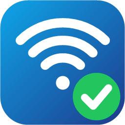

<p align="center">
  
</p>

<h1 align="center">GSBWIFI Otomatik Bağlantı</h1>

<p align="center">
  Windows'ta GSBWIFI "<b>İnternet yok, açık</b>" hatası verdiğinde Wi-Fi'ı kapatıp açan, giriş sayfasını Chrome'da açıp <b>Giriş</b>'e basan masaüstü uygulaması. İstersen yaptığı her şeyi ekranında ikinci bir imleçle canlı izlersin.
</p>

---

## Sorun

GSBWIFI'ye bağlanırken Windows sık sık şunu gösteriyor:

> **GSBWIFI — İnternet yok, açık**

Çözüm genelde bağlantıyı kesip yeniden bağlanmak. Bazen bu bir kez yetiyor, bazen saatlerce tekrar etmek gerekiyor. Bu uygulama o tekrarı otomatik yapıyor.

## Ne yapar?

1. Uygulamayı **sen açınca** çalışmaya başlar. Windows ile birlikte kendiliğinden başlamaz.
2. **Başlat**'a basınca Wi-Fi kapalıysa kendisi açar, sonra GSBWIFI'yi arar. Ağ listede yoksa Başlat gri olur ve hata gösterilir, ağ görününce açılır.
3. 4 saniyede bir **gerçek internet var mı** diye bakar (`msftconnecttest.com`, Windows'un kendi kullandığı kaynak).
4. GSBWIFI'ye bağlı değilsen bağlanmayı dener.
5. Bağlısın ama internet yoksa **giriş sayfasını (`wifi.gsb.gov.tr`) arka planda Chrome ile açar**. Sayfa açılırsa kullanıcı adı ve şifreyi yazar, **Giriş** düğmesine tıklar.
6. Sayfa açılmazsa ya da giriş sonrası internet gelmezse **Wi-Fi kartını kapatıp açar**, yeniden bağlanır ve giriş sayfası açılana kadar bunu tekrarlar.
7. **İnternet gelince** bildirim gösterir, birkaç saniye sonra kendini kapatır.

Chrome bulunamazsa Edge, o da yoksa doğrudan form gönderimi denenir.

## Arayüz

- **Solda:** Başlat / Durdur, **Görüntü** anahtarı, giriş bilgileri, arka plana alma.
- **Ortada:** o an ne olduğu (büyük durum, dört adımlı ilerleme çizgisi, deneme / Wi-Fi yenileme / süre sayaçları) ve altında kayıt.
- **Görüntü açıkken:** Programın yaptığı her şeyi **gerçek ekranında, farenin yanında gezen ikinci bir mavi imleçle** izlersin. Senin farene dokunulmaz. İmleç tıkladığı anda halka çıkar, yanında ne yaptığını yazan bir etiket durur.
  - Giriş sayfası görünür bir Chrome penceresinde açılır. İkinci imleç kullanıcı adı alanına, şifre alanına ve **Giriş** düğmesine gidip tıklar (alanlardaki yazı noktayla maskelenir).
  - Wi-Fi kapalıysa ya da kapatıp açmak gerekiyorsa imleç görev çubuğundaki Wi-Fi simgesine gidip tıklar, hızlı ayarlar paneli açılır ve Wi-Fi düğmesi kapanıp açılır.
  - Windows'un kendi hızlı ayarlar paneli her pencerenin üstüne çizildiği için ikinci imleç panelin içinde görünemez. İmleç panelin hemen sol kenarında, Wi-Fi düğmesinin hizasında durur.

## Kullanım

1. [Releases](../../releases/latest) sayfasından `GSBWifiOtomatik.exe` dosyasını indir.
2. Çift tıkla. Kurulum gerekmez.
   İlk açılışta kullanıcı adını ve şifreni **bir kez** girersin (aşağıda nasıl saklandığı yazıyor).
3. Bağlanınca kendi kapanır.

> Windows, imzasız bir uygulama olduğu için ilk açılışta "tanınmayan uygulama" uyarısı gösterebilir. **Daha fazla bilgi → Yine de çalıştır** ile geçebilirsin. Kaynak kodu bu depoda, derlemeyi kendin de yapabilirsin.

## Gereksinimler

- Windows 10 / 11
- Bilgisayarda GSBWIFI profilinin kayıtlı olması (ağa en az bir kez bağlanmış olmalısın)
- **Yönetici izni**: Wi-Fi kartını kapatıp açmak için gerekir. Uygulama her açılışta Windows'un izin penceresini gösterir.
- Ek bir şey yok. Uygulama Windows ile gelen .NET Framework 4 üzerinde çalışır.

## Demo (tanıtım videosu için)

`GSBWifiOtomatik.exe --demo` komutuyla, gerçek ağa ve gerçek hesaba dokunmadan örnek bir giriş sayfasında ikinci imleç gösterisi çalışır. Örnek sayfa adres çubuğunda kişisel bir ad göstermeyecek şekilde `C:\Users\Public\kullanici\login.html` yoluna yazılır. Kullanıcı adı olarak örnek bir değer (`12312312312`) kullanılır ve alanlardaki yazı zaten noktayla maskelenir.

## Giriş bilgileri

İlk açılışta iki seçenek sorulur (**Giriş bilgileri** düğmesinden sonradan değiştirilir):

- **Chrome'da bilgilerim kayıtlı:** Giriş sayfasında kullanıcı adı ve şifre Chrome'dan kendiliğinden doluyorsa bunu seç. Uygulama, Chrome profilinden kayıtlı şifre dosyalarını geçici bir klasöre kopyalar, sayfa dolunca Giriş'e basar ve klasörü siler. Chrome doldurmazsa bilgileri elle girmeni ister.
- **Bilgilerimi gireyim:** Kullanıcı adı ve şifre bir kez sorulur ve kaydedilir, bir daha sorulmaz. Sağdaki **Değiştir** düğmesiyle istediğin zaman güncellenir.

## Elle girilen bilgiler nerede duruyor?

- İlk açılışta bir kez sorulur, sonra sorulmaz. **Giriş bilgilerini değiştir** düğmesiyle güncellenir.
- Bilgiler `%APPDATA%\GSBWifiOtomatik\kimlik.dat` dosyasında, Windows'un kullanıcıya özel şifrelemesiyle (DPAPI) saklanır. Dosya yalnızca senin Windows hesabınla açılabilir.
- Kodda ve depoda hiçbir bilgi **yoktur**. Bilgiler sadece `wifi.gsb.gov.tr` giriş sayfasına gönderilir.

## Kendin derlemek

Depoyu indirip `build.bat` dosyasını çalıştır. Windows'ta hazır bulunan `csc.exe` derleyicisini kullanır, ek bir araç gerekmez.

```bat
build.bat
```

Çıktı: `GSBWifiOtomatik.exe`

## Ayarlar

`GSBWifiOtomatik.cs` dosyasının başındaki sabitlerden değiştirilir:

| Sabit | Varsayılan | Anlamı |
|---|---|---|
| `Ssid` | `GSBWIFI` | Bağlanılacak ağın adı |
| `TickMs` | `4000` | Kontrol aralığı (milisaniye) |

Başka bir açık ağda da aynı sorunu yaşıyorsan `Ssid` değerini değiştirip yeniden derlemen yeterli.

## Sınırlar

- Giriş sayfası değişirse (alan adları, adres, düğme yazısı) uygulamanın güncellenmesi gerekir. Captcha ya da SMS kodu varsa giremez. Tarayıcı, `%APPDATA%\GSBWifiOtomatik\chrome` altındaki ayrı bir profille çalışır, kendi Chrome'una dokunmaz.
- Sadece Wi-Fi bağlantısını yönetir. Ağın tarafındaki bir kesintiyi düzeltemez. Ağ kapalıysa döngü sürer, ağ gelince bağlanır.
- Komutlar Windows'un kendi `netsh wlan` aracı üzerinden çalışır.

## Proje yapısı

```
GSBWifiOtomatik.cs   Uygulamanın tamamı (C#, Windows Forms, Chrome DevTools Protocol)
build.bat            Derleme betiği
app.manifest         Yönetici izni isteği
assets/
  logo.png           Logo
  app.ico            Uygulama simgesi (16–256 px)
  icon-uret.ps1      Logoyu ve simgeyi üreten betik
```

## Lisans

Kişisel kullanım için serbest. Dilediğin gibi kullanabilir, değiştirebilirsin.
